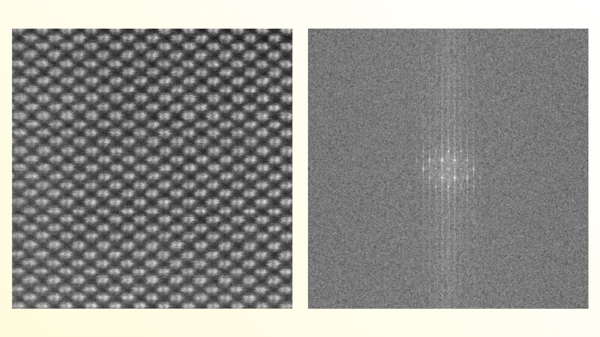
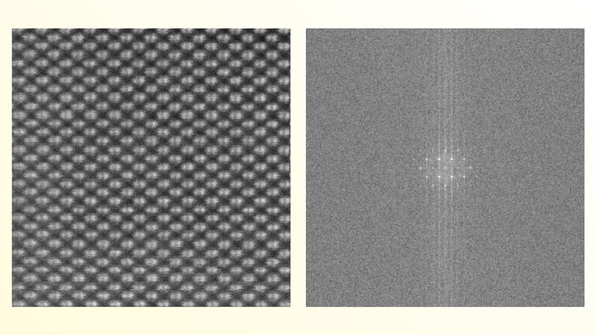

In the [previous post](#), I went through the core idea of *Correcting scanning instabilities from images of periodic structures* by Braidy et al.: scan-induced distortions smear Bragg spots into streaks in Fourier space, and those streaks carry the information needed to measure and correct the distortion.

This time, I've moved from the maths to the implementation. I reconstructed the original DigitalMicrograph (`.dm`) script as a Python script and ran it on an atomic-resolution lattice image. These are preliminary results, but they already show the expected behaviour.

### Before correction

<figure>
  
  <figcaption>Unprocessed lattice (left) and its FFT (right).</figcaption>
</figure>

In the raw image, the distortions are hard to spot by eye. In the FFT, though, the Bragg spots are visibly smeared into streaks along the slow-scan direction. This is exactly the signature predicted by the row-dependent phase factor $f_b$ from the derivation.

### After correction

<figure>
  
  <figcaption>Processed lattice (left) and its FFT (right).</figcaption>
</figure>

After applying the correction, the Bragg spots are much more compact. The streaks have shrunk back towards well-defined spots, which suggests that the row-by-row displacements have been estimated and removed.

### Takeaway

The correction **reduces the smearing in the Fourier transform**. This is a qualitative check so far, streaks are not completely gone. The next step is to quantify the improvement, vary different parameters for better results, and to test the method on more datasets.

I have reconstructed the original `.dm` script in Python, and I plan to make it available as a public Git repository in the future. The original script is available on the FELMI-ZFE website at [felmi-zfe.at/dm-script](https://felmi-zfe.at/dm-script/). Search the page for "correct flags and scripts" to find it.

Thankyou for reading!

### Reference

N. Braidy *et al.*, *“Correcting scanning instabilities from images of periodic structures,”* **Ultramicroscopy 118**, 67–76 (2012).\
DOI: **10.1016/j.ultramic.2012.04.001**

Original DigitalMicrograph script: [felmi-zfe.at/dm-script](https://felmi-zfe.at/dm-script/) (see "correct flags and scripts")
